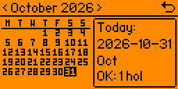
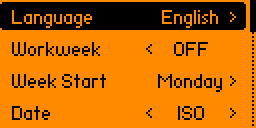
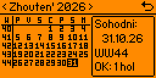
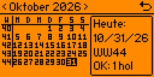
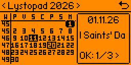
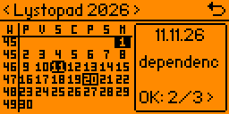

# Simple Calendar App for Flipper Zero


This repository contains an enhanced calendar application designed for the Flipper Zero device. The app provides a monthly calendar grid with optional Workweek (WW) numbers, multi-calendar (.ics) holiday tracking with scrolling text, customizable date formats, multilingual localization, and persistent settings.

Based on the original project by [TechArtDev](https://github.com/techartdev/Calendar).

## Features

- **Comprehensive Settings Menu:** Press and hold `OK` (`Hold OK: Set`) from the calendar view to access standard Flipper Zero Settings powered by `ViewDispatcher` and `VariableItemList`. Settings are automatically saved to `/ext/apps_data/techart_calendar/calendar.conf` via `flipper_format`.
  - **Language Support:** Choose between English, Ukrainian, Polish, and German. Adapts month names, short names, and day of the week column headers.
  - **Workweek Column Toggle:** Easily switch the Workweek (`WW`) column `ON` or `OFF` depending on your preference. When disabled, the grid seamlessly expands into 7 balanced columns.
  - **Customizable Week Start Day:** Choose whether the calendar week starts on `Monday` or `Sunday`.
  - **Configurable Numeric Date Formats:** Choose between European (`EU` -> `DD.MM.YY`), International (`ISO` -> `YYYY-MM-DD`), and American (`US` -> `MM/DD/YY`).
- **Interactive Information Side Panel:**
  - **Current Month:** Displays localized "Today" label, current date in the configured numeric format (`DD.MM.YY`, `YYYY-MM-DD`, or `MM/DD/YY`), Workweek (if enabled), and holiday count hint (`OK: 1 hol`).
  - **Browsing Other Months:** Displays Workweek range (`45-49`) or year, and holiday count hint (`OK: 2 hol`).
  - **Holiday Details & Running Marquee:** Press `OK` (short press) to cycle through all holidays in the current month. Displays numeric date, smooth running line (marquee) with holiday title, and interactive counter (`OK: 1/3 >`). Wrapping back returns to the month overview.
- **Compact Pixel Font (3x5):** Custom ultra-compact bitmap font designed specifically for the Flipper Zero 128x64 display with full multilingual glyph support (`P`, `V`, `S`, `C`, `N`, `M`, `D`, `W`, `T`, `F`).
- **Multi-iCalendar (.ics) Support & Automatic Directory Scanning:** Automatically scans the application data directory (`/ext/apps_data/techart_calendar/`) and loads all `.ics` files simultaneously (e.g. `poland.ics`, `custom_2026.ics`). Events from all files are aggregated, deduplicated, and sorted in chronological order.
- **Top Navigation Bar:** Clearly shows the active month and year (`< October 2026 >`) along with the exit shortcut.
- **Dynamic 5- & 6-Row Layout:** Seamlessly scales grid height and side-panel framing to support months spanning 5 or 6 rows without clipping.

## Screenshots

| Default View (ISO, No WW, Mon start) | Settings Menu (`VariableItemList`) |
| :---: | :---: |
|  |  |

| Ukrainian Locale (DD.MM.YY, WW ON) | German Locale (MM/DD/YY, WW ON) |
| :---: | :---: |
|  |  |

| iCalendar Holiday Marquee (1/3) | iCalendar Holiday Marquee (2/3) |
| :---: | :---: |
|  |  |

## Navigation

- **Left / Right:** Move between months.
- **Up / Down:** Move between years.
- **OK (Short Press):** Cycle through holidays of the active month or return to today.
- **OK (Long Press):** Open Settings menu (`Hold OK: Set`).
- **Back:** Exit Settings back to Calendar, or exit the application.

## Installation

1. Clone this repository to your local machine.
2. Follow the standard Flipper Zero development environment setup using `ufbt` to build the application:
   ```bash
   ufbt
   ```
3. Launch or flash the built application to your connected Flipper Zero:
   ```bash
   ufbt launch
   ```

## Contributing

Contributions are welcome! If you have suggestions for improvements or bug fixes, please feel free to fork the repository, make your changes, and submit a pull request.

## Authors

- **TechArtDev** - Original author ([Original Repository](https://github.com/techartdev/Calendar))
- **Taras Zakharchenko** ([@player999](https://github.com/player999)) - Co-author (Settings menu, multi-ICS parsing & scrolling, custom 3x5 font, multilingual localization, ISO/custom date formats)

## License

This project is licensed under the MIT License - see the [LICENSE](LICENSE) file for details.
- Copyright (c) 2024 TechArtDev
- Copyright (c) 2026 Taras Zakharchenko (player999)
